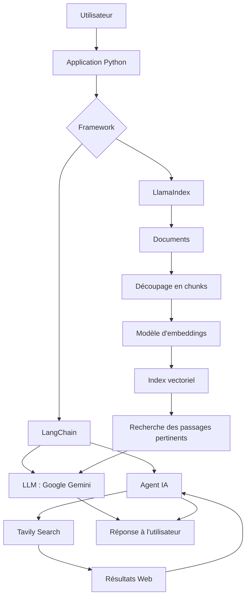

# Création d'agents IA avec LangChain et LlamaIndex

> Projet pratique de découverte et de mise en œuvre des LLM, du RAG et des agents IA avec Python, LangChain et LlamaIndex.

## Présentation

Ce projet explore la création d'applications d'intelligence artificielle générative capables de répondre à des questions, de rechercher des informations et d'exploiter des documents à l'aide de modèles de langage (LLM).

Deux frameworks sont étudiés :

- **LangChain** : orchestration des interactions avec les LLM, intégration d'outils et construction de workflows d'agents.
- **LlamaIndex** : ingestion, indexation et récupération de données pour construire des applications de questions-réponses, notamment avec le RAG.

Les exemples utilisent **Google Gemini** comme modèle de langage et **Tavily Search** comme outil de recherche Web lorsque cela est nécessaire.

## Objectifs pédagogiques

- Comprendre le rôle et le fonctionnement des LLM.
- Découvrir les principes du **Retrieval-Augmented Generation (RAG)**.
- Charger et structurer des documents pour la recherche d'information.
- Comprendre les embeddings et la recherche par similarité.
- Créer un système de questions-réponses basé sur des documents.
- Construire un agent capable de décider quand utiliser un outil.
- Implémenter le **Tool Calling** avec une recherche Web.
- Gérer un historique conversationnel simple.
- Comparer les approches de LangChain et de LlamaIndex.

## Architecture générale



*Cette architecture représente les composants étudiés dans le projet. Les éléments exacts dépendent du script et de la configuration utilisés.*

## Technologies

| Technologie | Rôle |
|---|---|
| Python | Langage de développement |
| LangChain | Orchestration des LLM et des outils |
| LlamaIndex | Ingestion, indexation et recherche documentaire |
| Google Gemini | Modèle de langage et génération des réponses |
| Tavily Search | Recherche Web pour les agents |
| Embeddings | Représentation vectorielle des textes |
| Vector store | Stockage et recherche de vecteurs, selon la configuration |
| python-dotenv | Chargement des variables d'environnement |

## Fonctionnalités étudiées

### 1. Appel direct à un LLM

Un script Python envoie un prompt à Gemini et affiche la réponse générée. Cet exercice permet de comprendre les paramètres du modèle, les messages système et utilisateur, ainsi que la gestion des clés API.

### 2. Questions-réponses avec LlamaIndex

Des documents sont chargés et indexés afin de répondre à des questions en s'appuyant sur leur contenu. Le pipeline RAG suit généralement ces étapes :

1. Charger les documents.
2. Découper les textes en passages si nécessaire.
3. Calculer les embeddings des passages.
4. Construire un index pour la recherche.
5. Récupérer les passages pertinents à partir d'une question.
6. Fournir le contexte récupéré au LLM pour générer une réponse.

### 3. Agent LangChain avec Tavily

Un agent utilise Gemini et peut appeler Tavily Search lorsqu'une recherche Web est utile. Les résultats de l'outil sont ensuite transmis au modèle afin de formuler une réponse.

### 4. Tool Calling

Le modèle peut demander l'exécution d'un outil en produisant un appel structuré. L'application exécute cet outil, transmet son résultat au modèle, puis récupère la réponse finale. Le modèle ne réalise pas lui-même la recherche : c'est le code de l'application qui exécute l'outil.

### 5. Historique conversationnel

Un historique de messages peut être conservé entre plusieurs questions afin que l'assistant réutilise les informations échangées au cours de la session. Dans les exemples simples, cet historique reste en mémoire et n'est pas persistant après l'arrêt du programme.

## Structure du projet

Exemple d'organisation possible, à adapter aux fichiers réellement présents dans le dépôt :

```text
From_Linkedin/
├── .env                  # Clés API et paramètres locaux (non versionné)
├── .env.example          # Modèle de configuration sans secrets
├── .gitignore
├── requirements.txt
├── chap01/
│   └── 01_gemini_api.py  # Appel direct à Gemini
├── chap02/
│   └── 02_03_qa_llamaindex.py
└── chap03/
    ├── 03_03_agent_langchain.py
    └── 03_04_agent_llamaindex.py
```

Les noms et numéros des scripts ci-dessus sont indicatifs : conserve les noms réellement utilisés dans ton projet.

## Prérequis

- Python installé (Python 3.11 ou 3.12 est un choix pratique pour limiter les problèmes de compatibilité des dépendances).
- Visual Studio Code ou un autre éditeur.
- Une clé API Google Gemini.
- Une clé API Tavily pour les exemples de recherche Web.
- Une connexion Internet pour appeler les API et télécharger les dépendances.

## Installation

### 1. Cloner le dépôt

```bash
git clone <URL_DU_DEPOT>
cd <NOM_DU_DEPOT>
```

### 2. Créer un environnement virtuel

Sous Windows PowerShell :

```powershell
python -m venv env_ai
.\env_ai\Scripts\Activate.ps1
```

Si l'environnement est déjà activé, ne le recrée pas.

### 3. Installer les dépendances

```bash
python -m pip install --upgrade pip
pip install -r requirements.txt
```

Les versions des bibliothèques LangChain et LlamaIndex évoluent. Si une fonction utilisée dans un ancien tutoriel n'est plus disponible, vérifie la version installée et adapte le code à l'API actuelle.

### 4. Configurer les variables d'environnement

Crée un fichier `.env` à la racine du projet :

```dotenv
GEMINI_API_KEY=ta_cle_google_gemini
GEMINI_MODEL=nom_du_modele_gemini_disponible
TAVILY_API_KEY=ta_cle_tavily
TEMPERATURE=0.5
MAX_TOKENS=600
```

Les noms des variables doivent correspondre à ceux lus dans tes scripts. Le nom du modèle doit être un identifiant valide disponible dans ton compte et compatible avec l'API utilisée.

Crée également un fichier `.env.example` avec des valeurs fictives, sans y mettre de vraies clés.

### 5. Protéger les clés API

Ajoute les lignes suivantes à `.gitignore` :

```gitignore
.env
env_ai/
.venv/
__pycache__/
*.py[cod]
.ipynb_checkpoints/
```

**Ne publie jamais tes clés API sur GitHub.** Si une clé est exposée, révoque-la et génère-en une nouvelle.

## Exécution des scripts

Depuis la racine du projet, active l'environnement virtuel puis lance le script souhaité. Exemples :

```powershell
python .\chap01\01_gemini_api.py
python .\chap02\02_03_qa_llamaindex.py
python .\chap03\03_03_agent_langchain.py
```

Adapte les chemins aux noms de tes fichiers.

## LangChain et LlamaIndex : différence

| Aspect | LangChain | LlamaIndex |
|---|---|---|
| Usage principal dans ce projet | Orchestrer un agent et ses outils | Indexer et interroger des documents |
| Recherche Web | Intégration de Tavily | Possible via des outils et intégrations |
| RAG | Possible | Fonctionnalité centrale |
| Tool Calling | Modèle connecté à des outils | Agents et outils également disponibles |
| Choix | Pratique pour composer des workflows | Pratique pour les applications centrées sur les données |

Les deux frameworks peuvent se compléter : LlamaIndex peut préparer et récupérer le contexte documentaire, tandis que LangChain peut orchestrer les étapes d'un workflow. Il n'est toutefois pas nécessaire d'utiliser les deux dans chaque application.

## Points à retenir

- Un **LLM** génère des réponses à partir du contexte qu'il reçoit et de ce qu'il a appris pendant son entraînement.
- Le **RAG** récupère des informations dans une source externe puis les fournit au LLM pour contextualiser sa réponse.
- Un **embedding** représente un texte sous forme de vecteur numérique.
- Un **vector store** permet de conserver et de rechercher ces vecteurs.
- Un **agent IA** peut choisir d'appeler un outil selon la tâche et les outils disponibles.
- Le **Tool Calling** décrit le mécanisme d'appel structuré d'un outil ; le code de l'application exécute généralement cet outil.

## Améliorations possibles

- Ajouter une interface utilisateur avec Streamlit ou Gradio.
- Accepter des fichiers PDF, DOCX et TXT fournis par l'utilisateur.
- Ajouter des citations et des références aux passages utilisés dans les réponses RAG.
- Tester plusieurs modèles d'embeddings et comparer la qualité de récupération.
- Ajouter un vector store persistant comme FAISS ou Chroma.
- Gérer les erreurs API, les limites de requêtes et les délais d'attente.
- Ajouter des tests automatisés et une journalisation.
- Évaluer la qualité des réponses, la pertinence des passages récupérés et le coût des appels API.
- Déployer l'application avec Docker ou sur une plateforme adaptée.

## Ressources officielles

- [Documentation LangChain](https://python.langchain.com/docs/)
- [Documentation LlamaIndex](https://docs.llamaindex.ai/)
- [Google AI for Developers](https://ai.google.dev/)
- [Documentation Tavily](https://docs.tavily.com/)
- [python-dotenv](https://pypi.org/project/python-dotenv/)

## Auteur

**Projet personnel de formation en IA générative**  
Thèmes : Python, LLM, RAG, agents IA, LangChain et LlamaIndex.

---

*Ce dépôt est un projet d'apprentissage. Les résultats dépendent des modèles, des documents, des outils et des versions des bibliothèques configurés.*
